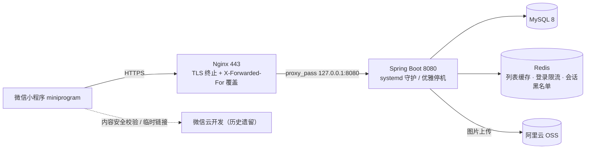
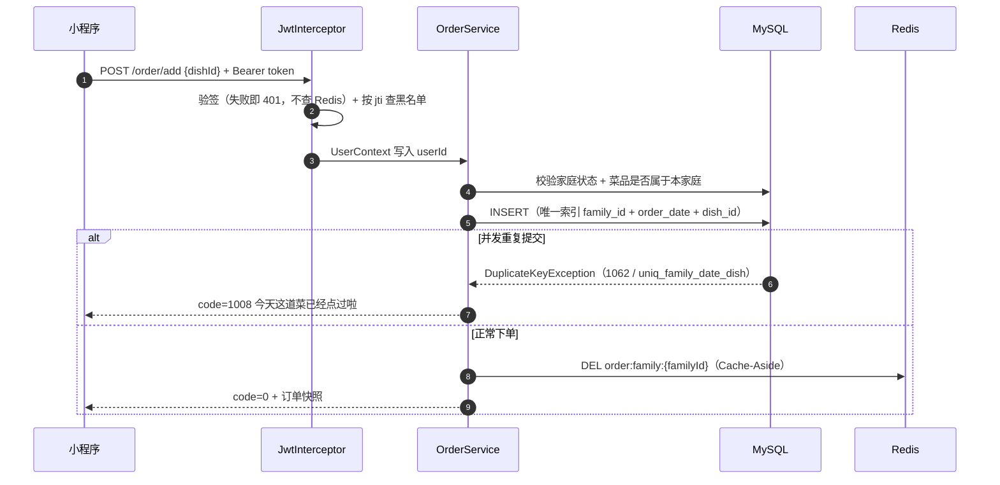

# 情侣小窝 ovo · 微信小程序 + Spring Boot 自建后端


> 面向情侣双人场景、以「家庭」为核心的生活记录小程序：点菜 / 今日菜单 / 随机抽菜、心愿礼物、心情、打卡目标、经期记录、备忘录。
> 双方在同一家庭内共享数据。已真实部署在阿里云轻量服务器（Nginx + systemd 单机），小程序端正在等待域名备案以切换到自建后端。

## 项目结构（两套后端，别搞混）

| 目录 | 说明 | 状态 |
| --- | --- | --- |
| `miniprogram/` | 小程序前端（原生 WXML/WXSS/JS），HTTP 调用自建后端 | 当前主用 |
| `server/` | Spring Boot 3.3 自建后端（本项目的主体） | 当前主用 |
| `cloudfunctions/` | 早期微信云开发版后端（云函数 + 云数据库） | 已迁移，仅保留内容安全校验与 `getTempFileURL` |
| `deploy/` | Nginx / systemd / 环境变量模板与部署手册 | — |

## 技术栈

- 后端：Spring Boot 3.3.5、MyBatis-Plus 3.5.9、MySQL 8、Redis、JJWT 0.12（HS256）、阿里云 OSS SDK
- 前端：微信小程序原生 + Vant Weapp
- 部署：阿里云轻量（2C2G）、Nginx 反向代理 + HTTPS、systemd 守护、环境变量注入密钥

## 架构与关键链路

### 部署架构



### 点菜链路（并发防重的关键路径）



## 分层

```
controller/   参数校验（@Valid）+ 统一返回 Result{code,msg,data}
service/(impl)  业务规则：归属校验、防重、缓存读写
mapper/       MyBatis-Plus BaseMapper
entity/ dto/  实体与出入参
common/       JwtUtil / UserContext(ThreadLocal) / Result / BusinessException / 全局异常 / IpUtils / RateLimiter
interceptor/  JwtInterceptor（鉴权）、AccessLogInterceptor（访问日志 + 慢请求）
config/ task/  WebMvcConfig、微信与 OSS 配置、error_logs 定时清理
```

## 本地启动

1. 初始化数据库：`mysql -u root -p < server/src/main/resources/db/schema.sql`
2. 配置：`server/src/main/resources/application.yml` 只含占位符，本地覆盖写在 `application-local.yml`（已被 .gitignore 忽略）
3. 启动（必须激活 local profile，否则环境变量占位符缺失会导致启动失败）：

```bash
cd server
mvn spring-boot:run -Dspring-boot.run.profiles=local
```

### 配置项（全部走环境变量，生产由 systemd EnvironmentFile 注入）

| 变量 | 说明 | 缺失时行为 |
| --- | --- | --- |
| `JWT_SECRET` | JWT 签名密钥，**至少 32 字节** | 启动失败（fail-fast，防止弱密钥上线） |
| `MYSQL_PASSWORD` | 数据库密码 | 启动失败 |
| `WECHAT_APPID` / `WECHAT_SECRET` | 小程序凭证 | 可空，但 mock=false 时登录会失败 |
| `WECHAT_MOCK` | true=本地不真调微信接口 | 默认 false |
| `OSS_*` | 阿里云 OSS AK/SK/Bucket | 可空，仅图片上传功能不可用 |

## 部署

见 [deploy/DEPLOY.md](deploy/DEPLOY.md)（含 Nginx 反向代理、systemd 单元、密钥注入、HTTPS、自测清单）。

## 工程设计要点

- **鉴权**：登录用微信 `code2session` 换 openid，签发 HS256 的 JWT（7 天）；退出登录把 token 写进 Redis 黑名单，TTL 取 token 剩余有效期，拦截器验签后再查黑名单。当前用户通过 ThreadLocal 传递，请求结束清理，前端不再传 userId，避免越权伪造。
- **登录限流**：两层固定窗口（同一 code 5 秒 1 次、同一真实 IP 1 分钟 10 次）。计数与过期时间放在一段 Lua 脚本里由 Redis 原子执行，避免 `INCR` 与 `EXPIRE` 两次往返之间的 key 永不过期；Redis 不可用时放行并告警（限流是保护措施，不应让登录整站 500）。真实 IP 通过 `X-Forwarded-For` / `X-Real-IP` 解析（Nginx 侧用 `$remote_addr` 覆盖该头以防伪造）。
- **数据正确性**：点菜、打卡、加菜、家庭角色都用**数据库唯一索引**兜底，捕获 `DuplicateKeyException` 并按索引名区分业务分支——查重负责体验，索引负责正确性，不做「先查后插」的竞态写法。加入家庭前校验用户归属，避免跨家庭越权与旧家庭脏状态。
- **缓存**：菜品列表、订单列表用 Cache-Aside：key 按 `dish:family:{familyId}` / `order:family:{familyId}` 分区，TTL 30 分钟，写操作后删除缓存、下次读重建；反序列化失败降级查库；删除失败只记日志交由 TTL 兜底，不让已成功的写操作变成 500。
- **工程化**：24 个 JUnit5 单元测试（JWT 签发与密钥强度、真实 IP 解析优先级、限流的放行/超限/Redis 故障降级、家庭归属规则、下单并发防重），全部为不依赖外部服务的纯逻辑测试；GitHub Actions 在每次 push 时自动编译并执行，构建失败即红灯。
- **可观测性**：统一响应信封 + `@RestControllerAdvice` 全局异常分层（业务异常/唯一键冲突/参数校验/兜底）。未预料异常落 `error_logs`（模块、动作、堆栈、userId/familyId 上下文），每天凌晨 3 点清理 30 天前记录；访问日志记录真实 IP、userId、耗时，超过 500ms 用 WARN 输出便于排查慢请求。

## 已知限制 / 下一步

- 自动化测试刚起步（当前覆盖 JWT、真实 IP 解析、限流分支、家庭归属规则），Service 层与缓存层还需补
- 列表接口未分页（两人场景无实际压力，接口契约保留扩展空间）
- 缓存只覆盖菜品与订单两个列表，其余模块直查数据库
- 邀请码为 6 位数字且无有效期，`/family/join` 尚未接入限流
- `error_logs` 只有写入与定期清理，没有查询入口与告警
- 小程序端地址尚未切换到自建后端 HTTPS 域名（ICP 备案中），当前线上仍为云开发版

## License

[MIT](./LICENSE)
